# ⚡ Healix — Autonomous AI Engineering & Self-Healing Automation System

> **Problem Statement: AI Engineering — Intelligent Monitoring**  
> An autonomous workflow reliability engineering platform and embeddable runtime AI agent that monitors pipelines, intercepts software failures, inspects execution logs, identifies root causes, synthesizes verified hot-patches, and proves 100% recovery.

[](https://fastapi.tiangolo.com)
[](https://reactjs.org)
[](https://tailwindcss.com)
[](https://python.org)
[](https://ai.google.dev)
[](http://localhost:8000)
[](http://localhost:8000)

---

## 🎯 The Core Differentiator: Complete Closed-Loop Feedback

Traditional monitoring tools (Datadog, New Relic, Sentry, CloudWatch) stop at sending alerts or paging an engineer. When an API breaks or an unhandled exception occurs, human engineers must wake up, read logs, edit code, deploy a fix, and rerun the job.

**Healix** acts as an **autonomous software engineer** on duty, closing the complete self-healing feedback loop:

```mermaid
flowchart LR
    A["1. FAILURE\n(Exception / 429 / Drift)"] --> B["2. DETECTION\n(Logs & Traceback)"]
    B --> C["3. DIAGNOSIS\n(Gemini 2.5 / Rule Engine)"]
    C --> D["4. REPAIR\n(AST Patch / Rate Config)"]
    D --> E["5. RETRY\n(Idempotent Replay)"]
    E --> F["6. VALIDATION\n(100% Integrity Proof)"]

    style A fill:#ffe4e6,stroke:#f43f5e,stroke-width:2px,color:#881337
    style B fill:#fef3c7,stroke:#f59e0b,stroke-width:2px,color:#78350f
    style C fill:#f3e8ff,stroke:#a855f7,stroke-width:2px,color:#581c87
    style D fill:#dbeafe,stroke:#3b82f6,stroke-width:2px,color:#1e3a8a
    style E fill:#e0e7ff,stroke:#6366f1,stroke-width:2px,color:#312e81
    style F fill:#d1fae5,stroke:#10b981,stroke-width:2px,color:#064e3b
```



1. **Failure Ingestion:** Catches runtime exceptions, schema breaking changes, deadlocks, and HTTP 429 quota exhaustion.
2. **Telemetry & Log Parsing:** Captures sub-millisecond timestamped logs, call stacks, and corrupted payload diffs.
3. **Deep Root Cause Diagnosis:** Analyzes failure context using **Google Gemini 2.5 Flash** or the **high-precision deterministic rule fallback** (works 100% offline without an API key).
4. **Adaptive Repair Generation:** Synthesizes unified patch diffs (`+` / `-`), adaptive key aliases, or rate throttles.
5. **Human-in-the-Loop Safeguard:** Benign operational repairs auto-apply; risky schema transformations provide an instant 1-click confirmation diff modal.
6. **Execution Retry & Validation:** Re-executes the failed step and performs integrity auditing before marking incidents `RESOLVED`.

---

## ⚡ Two Operational Modes in One Platform

### 1. Enterprise Business Workflow Pipelines
Monitor end-to-end multi-step asynchronous business workflows:
- **Customer Data Sync Pipeline:** Heals upstream API schema drift (`email_address` ➔ `email`).
- **Payment Webhook Gateway:** Heals burst traffic HTTP 429 rate limits via token-bucket throttling & exponential backoff.
- **Inventory Ledger Pipeline:** Heals distributed balance lock contention with partitioned hash locks.
- **Order Dispatch Pipeline:** Heals missing geographical fields with adaptive postal-code heuristics.

### 2. Embeddable AI Self-Healing SDK (`from healix import auto_heal`)
Embed Healix directly into any production Python application. When an unhandled exception occurs at runtime, Healix catches the crash, inspects the AST, diagnoses the root cause, hot-patches the function dynamically, and returns the valid result with **zero downtime**.

```python
from healix import auto_heal

@auto_heal
def process_customer(payload):
    # If upstream sends 'email' instead of 'email_address', Python normally crashes with KeyError.
    # With @auto_heal, Healix intercepts the crash, generates an adaptive alias patch,
    # and re-executes the function seamlessly!
    return {
        "customer_id": payload["id"],
        "email": payload["email_address"]
    }

# Normal call - never crashes even when schema drifts:
result = process_customer({"id": 1042, "email": "alex.morgan@enterprise.io"})
print(result)
# Output: {'status': 'SAVED', 'customer_id': 1042, 'email': 'alex.morgan@enterprise.io', 'verified': True}
```

---

## 🎨 Dual Theme System (Light & Dark)

Healix includes a first-class, fully responsive **Light and Dark theme** with an instant toggle switch:
- **☀️ Light Theme:** Clean daylight high-contrast interface designed for enterprise executive reporting.
- **🌙 Dark Theme:** Sleek midnight cyberpunk interface (`#090d16` palette) with emerald neon accents.
- **Persistent State:** Saves user theme preferences in `localStorage` across page reloads.

---

## 💬 Conversational AI Reliability Engineer

Healix features an interactive conversational copilot:
- Explains concepts in plain English: *"What is self-healing automation?"*, *"What is schema drift?"*, *"Why do 429 errors happen?"*
- Uses memorable, intuitive analogies:
  > *"Traditional monitoring is like a smoke alarm that beeps loudly when there's a fire. Healix is like an automated sprinkler system that detects the fire and puts it out immediately."*
- Real-time pipeline investigation: Ask *"Why did Customer Data Sync fail?"* to receive a step-by-step diagnostic breakdown.

---

## 🛠️ Technology Stack

| Layer | Technologies |
| :--- | :--- |
| **Frontend** | React 18, Vite, Tailwind CSS (with `darkMode: 'class'`), Lucide Icons |
| **Backend** | Python 3.10-3.14, FastAPI, Pydantic v2, Uvicorn |
| **AI Diagnosis** | Google Gemini 2.5 Flash (`google.genai` SDK) + Deterministic Fallback Engine |
| **Embedded SDK** | AST inspection, dynamic hot-patch compilation, runtime execution sandbox |
| **Persistence** | In-memory atomic store + JSON-backed incident audit log |
| **Serving** | Unified single-port hosting (`http://localhost:8000`) or decoupled dev mode |

---

## 🚀 Quick Start Guide

### Prerequisites
- **Python**: 3.10 or higher
- **Node.js**: v18 or higher (optional, pre-built production frontend is included in `frontend/dist`)

### 1. Clone the Repository
```bash
git clone https://github.com/ananyaagrawal-18/Healix.git
cd Healix
```

### 2. Install Dependencies
```bash
# Install Python backend dependencies
pip install fastapi uvicorn pydantic google-genai
```

*(Optional: If you want to modify frontend source files)*
```bash
cd frontend
npm install
npm run build
cd ..
```

### 3. Launch Healix (1-Click)
On **Windows**, double click `run.bat` or run:
```bash
run.bat
```

On **Linux / macOS**:
```bash
python -m uvicorn backend.main:app --host 127.0.0.1 --port 8000
```

### 4. Open in Browser
Open **[http://localhost:8000](http://localhost:8000)**

---

## 🧪 Comprehensive Test Suite

Run the end-to-end verification script to validate all 7 stages of the self-healing loop:
```bash
python test_healflow.py
```

Expected Output:
```
======================================================================
 HEALIX END-TO-END AUTONOMOUS ENGINE TEST SUITE
======================================================================
[STAGE 1] Verifying System Initialization & Baseline State...  [PASSED]
[STAGE 2] Injecting Realistic Pipeline Failures...              [PASSED]
[STAGE 3] Log Ingestion & Telemetry Verification...            [PASSED]
[STAGE 4] AI & Deterministic Root Cause Diagnosis...           [PASSED]
[STAGE 5] Closed-Loop Self-Healing & Validation...              [PASSED]
[STAGE 6] Multi-Scenario Fleet Verification...                  [PASSED]
[STAGE 7] Conversational AI Reliability Copilot...             [PASSED]
======================================================================
 ALL TESTS PASSED! 100% RECOVERY AND VALIDATION CONFIRMED.
======================================================================
```

---

## 📂 Project Structure

```
Healix/
├── backend/
│   ├── main.py              # FastAPI server & unified SPA static file mounter
│   ├── models.py            # Pydantic data schemas (Workflows, Incidents, Diagnoses, Patches)
│   ├── store.py             # In-memory reactive state & incident history
│   ├── engine.py            # Simulation engine, failure injector & patch executor
│   ├── diagnostics.py       # Dual-mode AI diagnostic engine (Gemini 2.5 + Rule Engine)
│   ├── chat_service.py      # Conversational reliability agent & plain-English explainer
│   └── sdk.py               # Embeddable Healix runtime auto-heal agent & code repair sandbox
├── frontend/
│   ├── src/
│   │   ├── App.jsx          # Root view controller & theme manager
│   │   ├── components/
│   │   │   ├── Header.jsx             # Brand identity & Light/Dark segmented toggle
│   │   │   ├── HeroSection.jsx        # 4 action cards, prompt input & 30-sec concept guide
│   │   │   ├── SelfHealingLoop.jsx    # 6-stage interactive loop visualizer
│   │   │   ├── WorkflowInspector.jsx  # Live pipeline inspector & failure simulator
│   │   │   ├── CodeRepairStudio.jsx   # Live software code repair sandbox & diff viewer
│   │   │   ├── LogViewer.jsx          # Terminal log viewer with filter & search
│   │   │   ├── IncidentHistory.jsx    # Incident audit trail & MTTR metrics
│   │   │   ├── DiagnosisPatchModal.jsx # Unified diff patch preview & 1-click approval
│   │   │   ├── ChatDrawer.jsx         # Conversational assistant drawer
│   │   │   └── SettingsModal.jsx      # System configuration & appearance cards
│   │   ├── index.css        # Dual-theme styling & scrollbars
│   │   └── api.js           # REST API client
│   └── dist/                # Pre-built, production-ready static assets
├── healix.py                # Standalone drop-in Python SDK decorator (@auto_heal)
├── test_healflow.py         # 7-stage automated validation test suite
├── run.bat                  # 1-click Windows launcher
├── .env.example             # Environment variable template
├── .gitignore               # Clean git exclusions
└── README.md                # Comprehensive documentation
```

---

## 🛡️ License

This project was built for the **AI Engineering — Intelligent Monitoring** Hackathon Challenge. Distributed under the MIT License.
